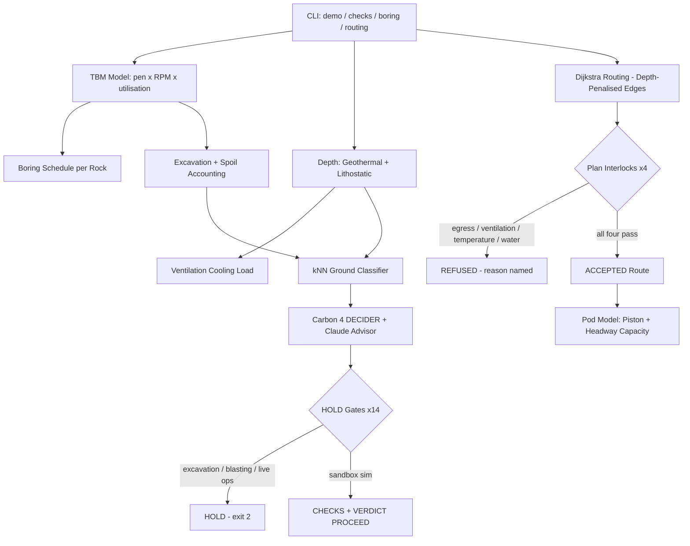
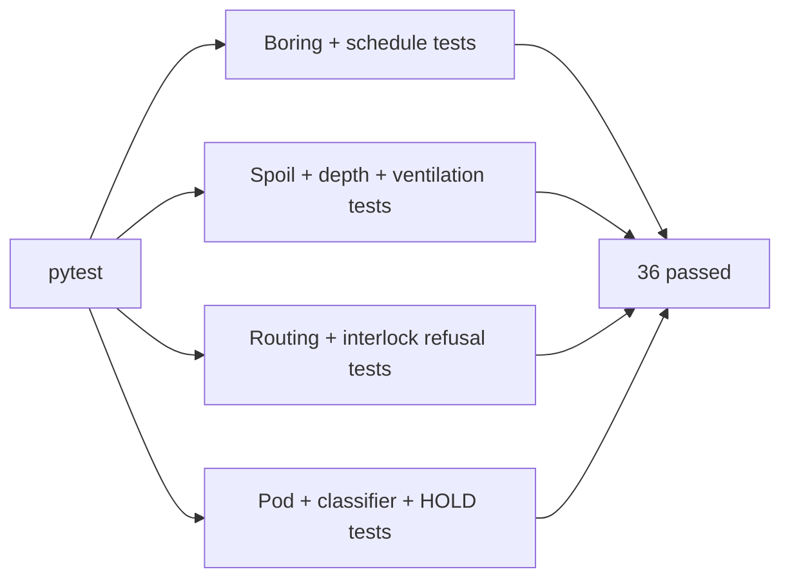
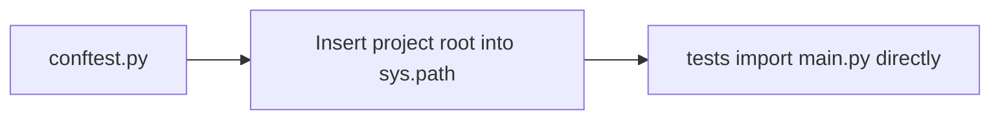
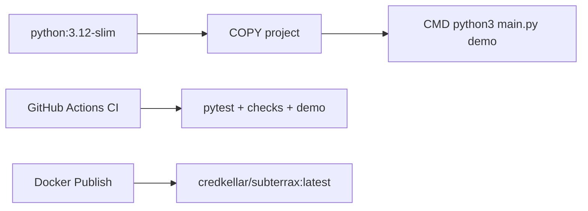

# SubterraX 🚇⛏️

**Underground Transport & Tunneling Lab** — an educational subterranean transport lab in ONE pure-Python file, by Darion Kellar. A **TBM advance-rate model** by rock type (penetration per revolution × RPM × utilisation), **excavation volumes and spoil mass** with a bulking factor, the **depth environment** (geothermal gradient, lithostatic pressure, ventilation cooling load), a deterministic station/shaft graph routed with **Dijkstra** over depth-penalised edges, a **pod model** with piston-effect and headway capacity, and **safety interlocks that REFUSE plans** — egress spacing, ventilation rate, rock temperature, water ingress — with the violated rule named. The famous tunnels (Gotthard Base 57 km, Channel 50.5 km, Laerdal 24.5 km) appear as **labelled published facts**, never as computed results. Simulation and learning only — it designs nothing buildable, guides no excavation, and every real-world construction / blasting / operation action sits behind a permanent HOLD gate (14 total). 🔒


> ℹ️ The two workflow badges above are the **live** GitHub Actions badges for this repo — they light up as soon as the `ci.yml` and `docker-publish.yml` files from the paste pack are pasted into `.github/workflows/`.

## 🧰 Tech Stack Badges & Full Architecture Tech Stack

### 💻 Core Programming Languages & Core Systems


- 🐍 Python 3.12, pure standard library (`math`, `heapq`, `hashlib`, `json`, `sys`) — ONE file: `main.py`
- ⛏️ Engineering core: TBM advance model (penetration × RPM × utilisation), excavation/spoil accounting with bulking factor, geothermal + lithostatic depth model, ventilation cooling-load sizing, Dijkstra routing from scratch on `heapq`, four-rule plan interlock auditor, pod piston-effect model
- 🧠 TinyML kNN ground classifier (from scratch, stdlib) on (UCS, depth, water risk)
- 🧑‍⚖️ Advisory seats inside `main.py`: Gemini Carbon 4 DECIDER (names-only, tighten-only, sha256 trace), Muse advisor (can_override_hold = False), Google Flow plan-only (rendered = False, live = 0)

### ⛓️ Web3 & Infrastructure

Not used — this lab is an offline engineering simulation. No blockchain, no Web3 libraries, no network calls of any kind.

### ⚙️ Platform Support & Hardware Architecture


- 🖥️ Runs anywhere Python 3.12 runs — Linux, macOS, Windows, any CPU architecture
- 🚫 Controls **no hardware**: no TBMs, no ventilation plants, no survey gear (all behind HOLD gates)

### ⚡ Low-Level Infrastructure & Performance


- 🚀 Zero dependencies, zero network, zero install friction for the lab itself
- 🎯 Deterministic end to end: run it twice, get byte-identical output
- 🔢 Closed-form engineering throughout — the only iteration is Dijkstra's search and the kNN sort

### 🛠️ DevOps & Build Tools


- 🐳 Docker image (`python:3.12-slim`), target: `credkellar/subterrax:latest`
- ⚙️ GitHub Actions CI + Docker Publish workflows — delivered in the paste pack for `.github/workflows/`

### ☁️ Cloud Providers

Not used — this lab runs fully offline on your own machine or in a local Docker container. No cloud account, no API keys, no hosted services.

## What this does?

1. ⛏️ **TBM boring model** — a tunnel boring machine advances one cutterhead revolution at a time: advance = penetration (mm/rev) × RPM × 60, converted to m/day through **utilisation**, the share of the day the machine actually bores. Granite: 5.0 mm/rev × 5 RPM × U = 0.35 → **12.60 m/day**. The rock table is labelled planning values: granite 200 MPa UCS, basalt, sandstone, clay, and the dreaded mixed face.
2. 🗓️ **The 10 km schedule** — one heading, 10 km: granite **793.7 days (2.17 yr)**, basalt 553.8, sandstone 285.8, clay 330.7 — and mixed face **1,736.1 days (4.75 yr)**, six times slower than sandstone. Same machine, same crew; the ground sets the schedule.
3. 🚛 **Excavation & spoil** — a 10 m bore is 78.54 m² of face: 10 km of granite is **785,398 m³** in situ, **1,256,637 m³** after the ×1.6 bulking factor, **2,120,575 tonnes** of spoil — **106,029 truck loads** or **2,121 spoil trains**. A tunnel is a quarry that moves.
4. 🌡️ **Depth: heat** — the geothermal gradient (labelled continental average 25 °C/km) takes rock from 15 °C at the surface to **40 °C at 1 km, 65 °C at 2 km, 72.5 °C under the Gotthard-class 2,300 m of overburden**.
5. 🏋️ **Depth: pressure + ventilation** — lithostatic pressure P = ρgh reaches **26.5 MPa per km** (60.9 MPa at 2.3 km). Hot rock heats the air through the walls: at 2 km the cooling load is **581.2 kW per km of tunnel**, needing **60.2 m³/s of air per km** to carry it out.
6. 📜 **Real tunnels, labelled** — Gotthard Base Tunnel **57 km** (longest rail tunnel, Switzerland, 2016), Channel Tunnel **50.5 km** (UK–France, 1994), Laerdal Tunnel **24.5 km** (longest road tunnel, Norway, 2000). Published facts, printed for scale — never claimed as computed.
7. 🗺️ **Subterranean routing** — a deterministic graph of 2 portals, 2 shafts, 3 stations and a junction, routed with a from-scratch **Dijkstra** where every edge's time is penalised +10% per km of depth. Fastest portal-to-portal: **12.55 min over 11,200 m** — via the 4,600 m express bore.
8. 🛑 **Safety interlocks** — every plan is audited against four rules and **REFUSED with the reason named**: the fastest route dies on `EGRESS_SPACING` (4,600 m > the 3,000 m egress rule), the deep Gamma run dies on `ROCK_TEMPERATURE` (67.5 °C rock, no refrigeration), a wet link without grouting dies on `WATER_INGRESS`, and a starved fan dies on `VENTILATION_RATE`. The compliant route — **14.11 min over 12,900 m** — is ACCEPTED.
9. 🚄 **Pod model** — a 3.5 m pod in an 8 m bore is a loose piston: blockage ratio 0.191, pressure pulse **70.1 Pa** at 80 km/h. Capacity comes from the headway, not the pod: 120 s headway → **30 pods/h → 1,200 passengers/h** per direction.
10. 🏷️ **kNN ground classifier** — labels any (UCS, depth, water risk) point `favourable` / `difficult` / `prohibitive`, consistent with the boring model: shallow dry sandstone is favourable, granite at 1 km is difficult, deep hot granite and deep wet mixed face are prohibitive.
11. 🧠 **Advisory seats + checks** — Carbon 4 DECIDER with sha256 trace, Muse advisor, Google Flow plan-only, and a built-in CHECKS suite (64 checks).

## 🗺️ How it works — diagram per script

### `main.py` — the whole lab



### `tests/test_main.py` — verification



### `conftest.py` — test path setup



### `Dockerfile` + CI — container & workflow flow



## Why is this cool?

1. ⛏️ It prices the ground, not the machine: the same TBM is a 35 m/day sandstone sprinter and a 5.76 m/day mixed-face crawler — the rock writes the schedule.
2. 🗓️ Utilisation is the honest multiplier everyone forgets: the cutterhead math says 36 m/day in granite; the calendar says 12.6, and the difference is segment erection, maintenance and mucking out.
3. 🚛 A tunnel is a quarry that moves: 10 km of railway means 2.12 million tonnes of granite riding trucks and trains out of a hole.
4. 🌡️ Depth is a furnace with a lid: 65 °C rock and 53 MPa of overburden at 2 km, from two lines of arithmetic anyone can check.
5. ❄️ The ventilation plant is a refrigerator the size of a river — 581 kW of cooling per kilometre at 2 km depth, sized from the heat balance, not guessed.
6. 🗺️ The fastest route is a trap: Dijkstra finds the express bore in 12.55 minutes, and the interlock layer refuses it by name. Speed is not the same as allowed.
7. 🛑 Refusals are specific: `EGRESS_SPACING`, `VENTILATION_RATE`, `ROCK_TEMPERATURE`, `WATER_INGRESS` — a plan learns exactly which rule it broke and what fixes it (refrigeration, grouting, more air).
8. 🚄 The pod is a piston: one blockage ratio turns cruise speed into a 70 Pa pressure pulse rolling ahead of every vehicle.
9. 📜 The giants are labelled, not laundered: Gotthard's 57 km is a published fact printed next to the models, never passed off as a model output.
10. 🎯 Deterministic end to end: run it twice, get byte-identical output — tunneling arithmetic you can diff.

## What problems this solves?

1. ❌ **Problem:** Tunnel schedules get quoted from cutterhead penetration alone, ignoring utilisation. ✅ **Solution:** The boring model multiplies pen × RPM × utilisation in the open, so the calendar rate (12.6 m/day in granite) is never confused with the boring rate (36 m/day).
2. ❌ **Problem:** Spoil is an afterthought until the trucks queue up. ✅ **Solution:** The excavation module turns bore diameter and length into in-situ volume, bulked volume, tonnage, truck loads and train loads before a single metre is bored.
3. ❌ **Problem:** "It's just deeper" hides the heat problem. ✅ **Solution:** The geothermal model prices depth in degrees — 40 °C at 1 km, 65 °C at 2 km — and the interlock refuses uncooled plans past the 60 °C rock limit.
4. ❌ **Problem:** Overburden pressure is invisible in flat planning maps. ✅ **Solution:** Lithostatic pressure is computed per depth (26.5 MPa/km), so a 2.3 km crossing carries its 60.9 MPa on the page.
5. ❌ **Problem:** Ventilation gets sized by habit. ✅ **Solution:** The cooling-load model derives required airflow from wall area, rock temperature and allowed air rise — 60.2 m³/s per km at 2 km depth.
6. ❌ **Problem:** Route planners optimise minutes and ignore egress. ✅ **Solution:** Dijkstra's fastest route is audited segment by segment; a 4,600 m bore between egress points is refused, and the compliant 14.11-minute route is offered instead.
7. ❌ **Problem:** Safety rules live in PDFs nobody re-reads at design time. ✅ **Solution:** Four interlocks — egress, ventilation, temperature, water — run on every plan and refuse with the violated rule named.
8. ❌ **Problem:** Wet ground surprises become floods. ✅ **Solution:** Water-ingress risk is a plan input: high-risk geology without a grouting programme is refused before it is routed.
9. ❌ **Problem:** Pod capacity claims ignore signalling. ✅ **Solution:** The pod model derives capacity from headway (120 s → 30 pods/h → 1,200 passengers/h), with the piston pulse printed beside it.
10. ❌ **Problem:** Simulation tools quietly imply construction readiness. ✅ **Solution:** Every rate is labelled a model value, published tunnel facts are labelled as published, and 14 HOLD gates return exit code 2 for every real excavation, blasting and operation action.

## How to install this?

1. 📋 Clone or download this project folder.
2. 🐍 Make sure Python 3.12+ is installed: `python3 --version`
3. ▶️ Run the full demo + checks (no arguments needed):

```bash
python3 main.py
```

4. 🧪 Run the test suite:

```bash
pip install pytest
python3 -m pytest -q
```

5. 🎛️ Try the other commands:

```bash
python3 main.py checks    # 64 built-in checks
python3 main.py boring    # TBM schedule table for 10 km, as JSON
python3 main.py spoil     # excavation + spoil for all rock types, as JSON
python3 main.py depth     # temperature / pressure / cooling vs depth, as JSON
python3 main.py history   # labelled real-tunnel references, as JSON
python3 main.py routing   # fastest vs compliant route, as JSON
python3 main.py plans     # the interlock plan book: accepted + refused
python3 main.py pods      # pod piston + capacity report, as JSON
python3 main.py classify  # kNN ground verdicts
python3 main.py brains    # Carbon 4 + Muse + Flow seats
python3 main.py holds     # list all 14 HOLD gates
python3 main.py hold-demo # exits 2 - gated actions stay HOLD
```

6. 🐳 Or run it in Docker:

```bash
docker build -t credkellar/subterrax:latest .
docker run --rm credkellar/subterrax:latest
```

## Requirements

- 🐍 Python 3.12 or newer
- 📦 Dependencies: **none** (standard library only)
- 🌐 Network: **none** — fully offline
- 🧪 For tests only: `pytest`
- 🐳 Optional: Docker

## FULL project structure tree

```text
subterrax/
├── main.py                  # the whole lab: TBM model, spoil, depth environment, references, Dijkstra routing, interlocks, pod model, classifier, seats, HOLD gates
├── conftest.py              # puts the project root on sys.path for tests
├── tests/
│   └── test_main.py         # 36 pytest tests: boring, spoil, depth, ventilation, routing, interlocks, pod, classifier, gates, determinism
├── assets/
│   └── cover.png            # README cover image (2736 x 912)
├── Dockerfile               # python:3.12-slim, runs the demo
├── .gitignore               # __pycache__, .pytest_cache, *.pyc
└── README.md                # this file
```

> 📦 Delivered separately as paste packs (not in this tree): `.github/workflows/ci.yml` + `docker-publish.yml`, and the Docker Hub pack (100-char description, 350-char About, overview, categories).

## 🔒 HOLD gates — all 14, permanent

| Gate | Rule |
|---|---|
| real_excavation_guidance | No guidance for any real excavation; this lab plans on paper only |
| blasting_guidance | No blasting or explosives guidance of any kind, ever |
| tbm_operation_live | No operating, driving or maintaining a real tunnel boring machine |
| construction_instruction | No construction instructions for real tunnels, shafts or stations |
| mine_operation_claim | No real mine operation; simulated headings are not workings |
| structural_certification_claim | No certifying any real tunnel safe or structurally sound |
| geological_survey_live | No interpreting live survey data for a real site or face |
| emergency_evacuation_live | No live emergency or evacuation direction; egress math here is a planning model |
| commercial_service_claim | Educational lab, not a commercial transport service or product |
| investment_claim | No investment advice about tunneling, mining or transport companies |
| guaranteed_schedule_claim | No guaranteed real schedule or cost; every rate here is a labelled model value |
| weapons_application_claim | No weapons application guidance of any kind |
| trespass_tunneling_guidance | No guidance for unauthorised digging, tunnelling or subsurface trespass |
| subsurface_rights_claim | No legal claims or advice about subsurface ownership or rights |

🧑‍⚖️ **Seats:** Gemini Carbon 4 DECIDER (MAP→MODEL→STRESS→DECIDE, names-only, tighten-only, sha256 trace) · Muse advisor (can_override_hold = False) · Google Flow plan-only (rendered = False, live = 0).

✅ **Verification:** pytest 36 passed · CHECKS 64/64 · double-run byte-identical · hold-demo exits 2.

## 🧒 5th-grade English section

Imagine digging a very long tunnel under a mountain, the way a mole digs — but with a machine as wide as a house. 🕳️

- The machine chews the rock with a giant spinning face. In soft rock it chews fast; in hard granite it chews **slowly** — about as far as a school bus is long, each day. 🚌
- All the chewed-up rock has to go somewhere! A 10 km tunnel makes enough broken rock to fill **over a hundred thousand trucks**. 🚛
- The deeper you dig, the **hotter** the rock gets — deep under a mountain it can be hotter than a summer day in the desert, so giant fans blow cool air down, like a refrigerator for a tunnel. 🌡️
- The rock above also **squeezes** harder and harder the deeper you go. Engineers have to plan for the squeeze.
- Smart planners draw maps of stations and shafts and ask: "If something goes wrong, can people always reach a safe exit soon?" If a tunnel stretch is **too long without an exit, the plan is refused** — the computer says NO and says why. 🛑
- Little pods can zip through the tunnel carrying people, pushing a pillow of air in front of them as they go. 🚄
- This project is a **pretend lab on a computer**. It does the math of tunnels — it does not dig anything real. 💻

---

MIT © 2026 Darion Kellar · SubterraX — educational simulation only 🚇
